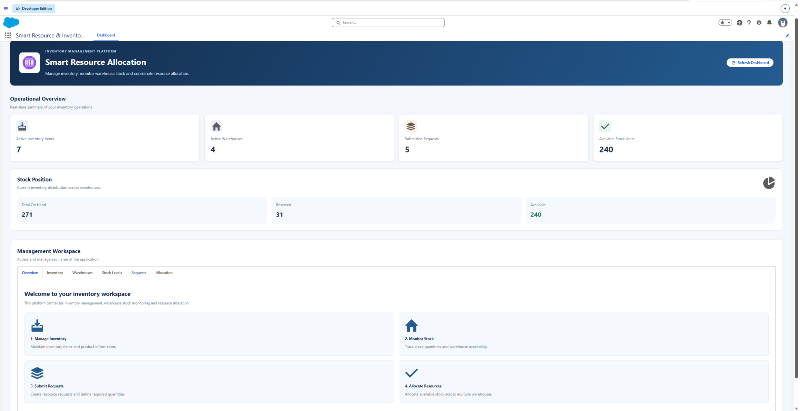
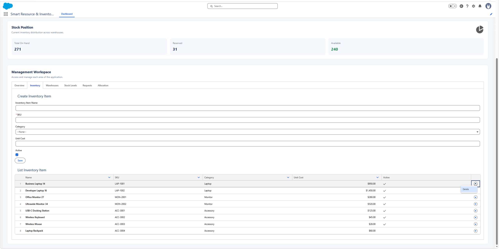
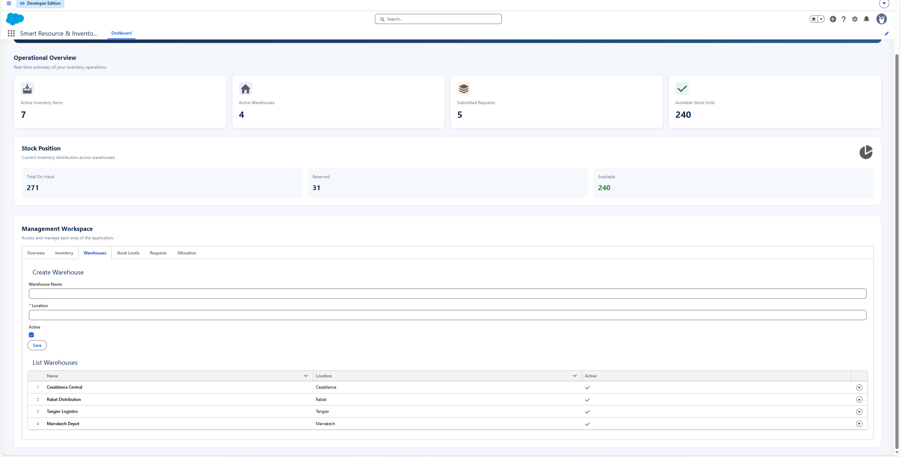
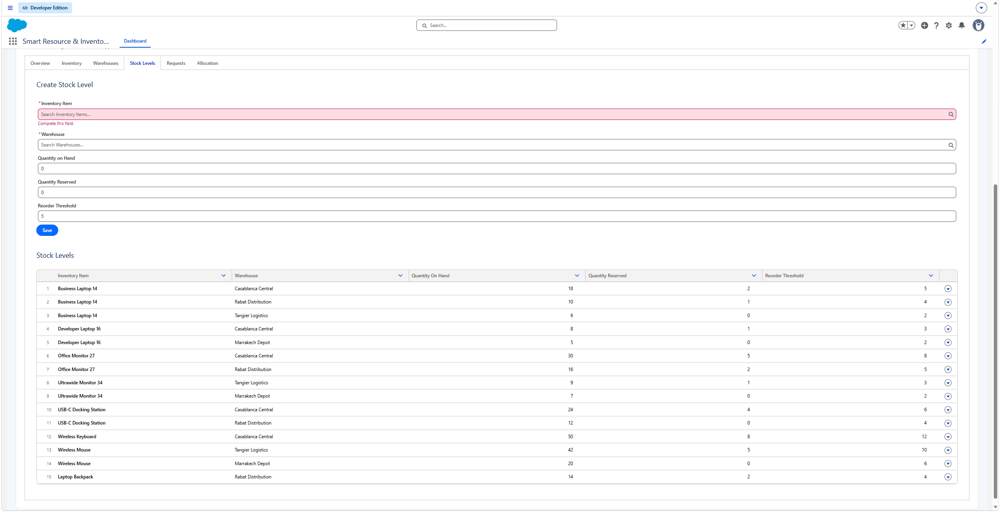
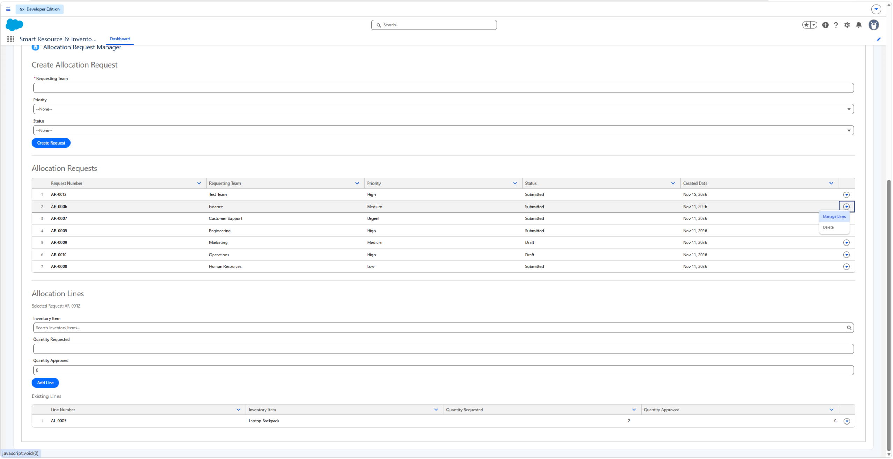
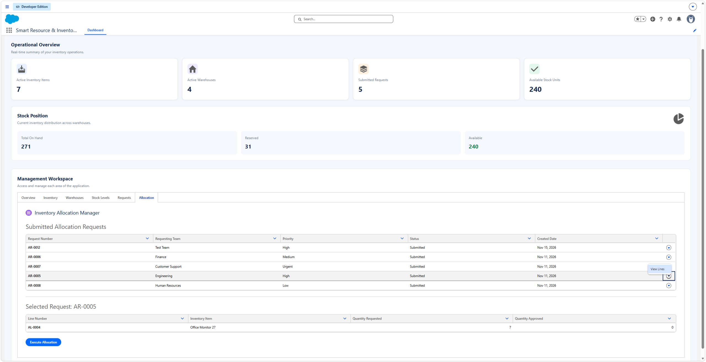

# Smart Resource & Inventory Allocation

A Salesforce application designed to streamline inventory management, warehouse stock monitoring, and resource allocation through Apex, Lightning Web Components (LWC), and Salesforce security features.

## Overview

Smart Resource & Inventory Allocation is a Salesforce application that helps organizations manage inventory across multiple warehouses and allocate available stock to internal teams.

The application provides centralized inventory visibility, allocation request management, automated stock allocation, and a dashboard for monitoring inventory operations.

It was developed as a Salesforce portfolio project to demonstrate Salesforce development skills, business logic implementation, data modeling, automation, and application security.

## Business Problem

Organizations managing inventory across multiple warehouses may face several challenges:

- Limited visibility into available stock across different locations.
- Difficulty tracking inventory reservations.
- Manual allocation processes that can lead to stock inconsistencies.
- Risk of allocating more stock than is available.
- Limited visibility into allocation requests and inventory performance.

## Solution

The application provides a centralized Salesforce solution that allows users to manage inventory, submit allocation requests, and allocate available stock across warehouses.

Its allocation engine validates requests, checks stock availability, and distributes requested quantities across warehouses while maintaining stock reservation consistency.

## Key Features

### 1. Inventory Management
- Create, view, update, and delete inventory items.
- Manage product SKUs, categories, costs, and active status.
- Centralize inventory information.

### 2. Warehouse Management
- Manage multiple warehouses.
- Maintain warehouse locations and active status.
- Associate stock levels with specific warehouses.

### 3. Stock Level Management
- Track physical stock quantities.
- Monitor reserved quantities.
- Calculate available stock dynamically.
- Configure reorder thresholds.
- Prevent duplicate item/warehouse stock records.

### 4. Allocation Request Management
- Create allocation requests.
- Define requesting teams and request priorities.
- Add inventory items and requested quantities.
- Track request statuses.

### 5. Intelligent Stock Allocation
- Process submitted allocation requests through Apex.
- Validate request status before processing.
- Check stock availability across multiple warehouses.
- Distribute requested quantities across warehouses when necessary.
- Prevent duplicate allocation processing.
- Lock stock records during allocation to reduce concurrent allocation conflicts.
- Update reserved quantities after successful allocation.
- Roll back unsuccessful transactions to preserve data consistency.

**Stock reservation logic**

The application distinguishes physical stock from reserved stock:

- Available Stock = Quantity On Hand − Quantity Reserved
- Successful allocation increases the reserved quantity.
- Physical stock on hand remains unchanged during reservation.

This approach separates stock reservation from physical stock dispatch or fulfillment.

### 6. Inventory Dashboard
A centralized Lightning dashboard provides an overview of inventory operations, including:

- Active inventory items.
- Active warehouses.
- Submitted allocation requests.
- Total stock on hand.
- Total reserved stock.
- Total available stock.

The dashboard also provides access to the application's main functional modules.

## Salesforce Architecture

The application follows a service-oriented Apex architecture, separating data retrieval, business logic, and user interface responsibilities.

### Apex Services

| Apex Class | Responsibility |
|---|---|
| `InventoryService` | Inventory item data retrieval |
| `WarehouseService` | Warehouse data retrieval |
| `StockLevelService` | Stock level data retrieval |
| `AllocationRequestService` | Allocation request and line retrieval |
| `InventoryAllocationService` | Core stock allocation business logic |
| `InventoryDashboardService` | Dashboard metrics and data |

### Lightning Web Components

| LWC Component | Responsibility |
|---|---|
| `inventoryItemManager` | Inventory item management |
| `warehouseManager` | Warehouse management |
| `stockLevelManager` | Stock level management |
| `allocationRequestManager` | Allocation requests and lines |
| `inventoryItemAllocationManager` | Allocation processing |
| `inventoryAllocationDashboard` | Main dashboard and navigation |

## Data Model

The application uses the following custom Salesforce objects:

- `Inventory_Item__c`
- `Warehouse__c`
- `Stock_Level__c`
- `Allocation_Request__c`
- `Allocation_Line__c`
- `Stock_Allocation__c`

### Main Relationships

- Inventory Item → Stock Level: Master-Detail
- Warehouse → Stock Level: Master-Detail
- Allocation Request → Allocation Line: Master-Detail
- Allocation Line → Stock Allocation: Master-Detail
- Allocation Line → Inventory Item: Lookup
- Stock Allocation → Stock Level: Lookup

## Security Model

The application implements Salesforce's declarative security model to provide differentiated access according to user responsibilities.

### Permission Sets

Two permission sets define the application's access levels:

**Inventory User**
- Consult inventory items, warehouses, and stock levels.
- Create and manage allocation requests.
- Add and update allocation request lines.
- View allocation results.

**Inventory Manager**
- Manage inventory items, warehouses, and stock levels.
- Manage allocation requests and allocation lines.
- Execute stock allocation operations.
- Create and consult stock allocation records.

### Additional Security Configuration

- Object-Level Security (OLS).
- Field-Level Security (FLS).
- Organization-Wide Defaults (OWD).
- Role Hierarchy.
- Apex Class Access.
- Dedicated user accounts for testing different access levels.

## Technologies Used

- Salesforce Platform
- Apex
- Lightning Web Components (LWC)
- SOQL
- JavaScript
- HTML
- CSS
- Salesforce Flow Builder
- Salesforce Permission Sets
- Salesforce Role Hierarchy
- Salesforce Sharing Settings
- Apex Unit Testing

## Testing

The allocation service was tested against key business scenarios:

- Successful allocation across multiple warehouses.
- Insufficient stock handling.
- Prevention of duplicate allocation processing.
- Rejection of requests that are not submitted.
- Verification of stock reservation updates.

The application was also tested using dedicated Inventory User and Inventory Manager accounts to validate differentiated access.

## Application Screenshots

Screenshots will be added here to demonstrate the application's user interface and main workflows.

### Dashboard

### Inventory Management

### Warehouse Management

### Stock Level Management

### Allocation Request Management

### Stock Allocation

## Project Objectives

This project demonstrates practical Salesforce development capabilities, including:

- Designing a Salesforce data model.
- Implementing Apex business logic and service classes.
- Developing reusable Lightning Web Components.
- Managing Salesforce data through SOQL and DML.
- Implementing transactional validation and error handling.
- Applying Salesforce security best practices.
- Building a business-oriented Lightning application.

